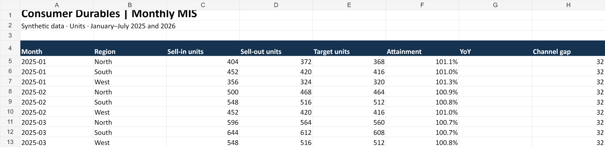

# Consumer Durables Sales MIS

An analytics portfolio case study using fictional distributor and retail sales. It shows how monthly extracts become a leadership report with regional target attainment, year-over-year volume and a sell-in versus sell-out gap. All data is synthetic.

## June 2026 management readout

| Region | Retail sell-out | Target | Attainment | YoY | Sell-in less sell-out |
| --- | ---: | ---: | ---: | ---: | ---: |
| North | 676 | 656 | 103.0% | +2.4% | 32 units |
| South | 700 | 704 | 99.4% | −1.1% | 32 units |
| West | 540 | 608 | 88.8% | −11.8% | 160 units |

**Action for West.** Review dealer-level sell-through and on-hand stock before sending more units. West missed target by 68 units and had the largest channel gap. A sell-in gap is a signal to investigate. Calculate inventory separately from opening balance, movements, returns and closing stock.

## Open the files

- [Excel workbook](Consumer-Durables-MIS.xlsx) has a regional monthly summary, a weekly summary, the cleaned transactions and an XLOOKUP dealer mapping check.
- [SQL report](monthly_mis.sql) aggregates sales to month and region before joining one target per month and region. Missing targets and missing or zero comparison denominators produce blanks.
- [Power Query script](clean_sales.pq) combines the monthly files, normalizes keys, checks both mappings, and drops duplicate transaction IDs.
- [Sample package](MIS-sample-data.zip) includes the 14 source extracts, mappings, targets, and checked CSV outputs.

## Refresh and reconcile

1. Run `python run_mis.py` with Python 3.10+ to regenerate the fixed demo inputs and execute the SQLite report. The script creates 338 raw rows, accepts 336, and separates one duplicate and one unmapped row. The SQL result reconciles to cleaned sell-out units.
2. To try the Excel Power Query workflow, extract the sample ZIP and paste `clean_sales.pq` into a blank query's Advanced Editor. Point `Root` at the extracted `sample` folder. Load the query to a table and insert a PivotTable with Region in rows, a custom Week Monday column (Power Query expression Date.StartOfWeek([sale_date], Day.Monday)) in columns, and sums of Sell In and Sell Out in values. Compare the totals with the workbook's weekly summary and the accepted row count with the SQL run.
3. To reproduce visuals in Power BI Desktop, import `results/monthly_mis.csv` and set the numeric column types. Build a line chart for sell-out by month, a clustered bar for sell-in and sell-out by region, and a region-by-month target matrix. For rollups, calculate attainment from the sum of sell-out and sum of targets over rows with valid targets. Use the supplied YoY percentage only at its stored region-month grain.

The workbook is a checked snapshot with formulas. The Power Query script and PivotTable setup steps are supplied separately. The Power BI steps are a report recipe.
